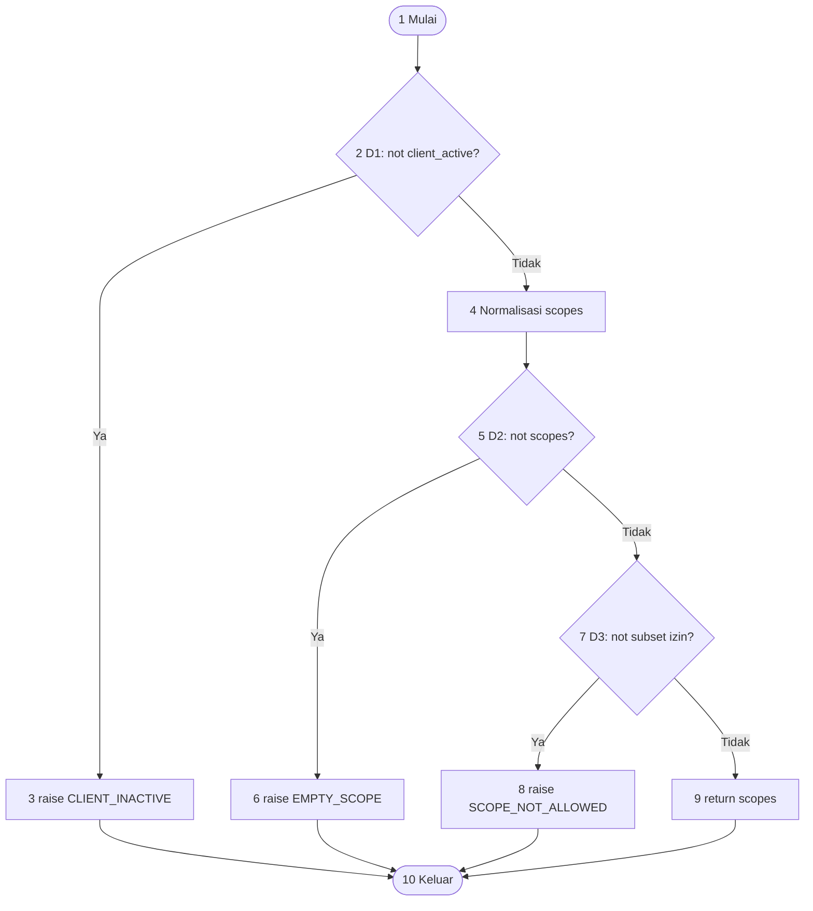
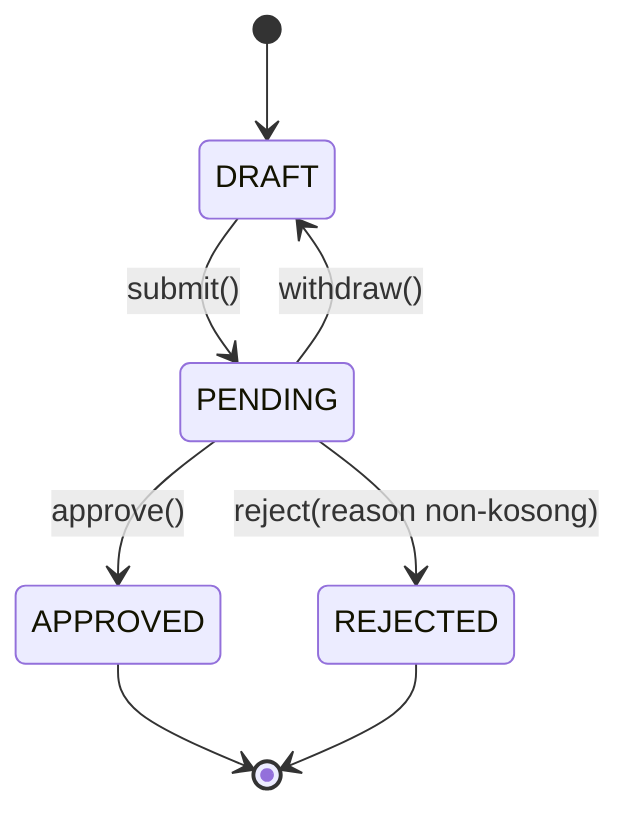

# Analisis Sesi 10 - Auth ZENTA

Tugas individu Bambang Herlambang. Model Python ini dibuat untuk pengujian;
tidak mengganti kode TypeScript pada repo kelompok dan tidak mengakses layanan online.

## Kontrak prosedural

`validate_scopes(client_active, requested_scope, allowed_scopes)` menerima client
aktif dengan permintaan scope tidak kosong dan seluruh scope diizinkan.
Pemanggil sudah memverifikasi identitas client. Tipe masukan merupakan precondition:
`bool`, `str`, dan `frozenset[str]`. Scope case-sensitive, dipisah whitespace,
dan duplikat dibuang. Fungsi mengembalikan `frozenset`, tidak mengubah allowlist.

Urutan pemeriksaan: client aktif (D1), scope tidak kosong (D2), subset izin (D3).
Jika beberapa kondisi gagal, error pertama yang berlaku dikembalikan.

## CFG

Node 10 adalah exit virtual bersama untuk return dan exception. Exception yang
ditangani test tetap merupakan jalur keluar yang sah dalam CFG fungsi ini.
Operasi bawaan `split`, `frozenset`, dan `issubset` diperlakukan sebagai satu blok
masing-masing; internal library tidak diekspansi.

N = 10, E = 12, komponen P = 1.

- V(G) = E - N + 2P = 12 - 10 + 2 = **4**.
- V(G) = jumlah keputusan biner + 1 = 3 + 1 = **4**.
- Pada embedding planar CFG tersebut terdapat 4 region termasuk region luar.

| Jalur | Urutan node | D1/D2/D3 | Masukan pokok | Oracle / test |
|---|---|---|---|---|
| P1 | 1-2-3-10 | T/-/- | client nonaktif, `read:catalog` | CLIENT_INACTIVE / `test_p1_inactive_client_is_rejected` |
| P2 | 1-2-4-5-6-10 | F/T/- | aktif, scope `""` | EMPTY_SCOPE / `test_p2_empty_scope_is_rejected` |
| P3 | 1-2-4-5-7-8-10 | F/F/T | aktif, `admin:users` | SCOPE_NOT_ALLOWED / `test_p3_disallowed_scope_is_rejected` |
| P4 | 1-2-4-5-7-9-10 | F/F/F | aktif, reserve/commit/release | himpunan izin yang sama / `test_p4_allowed_scopes_are_returned` |

T/F mengikuti ekspresi negatif pada kode, bukan label bisnis aktif/tidak aktif.
Allowlist fiktif: read:catalog, reserve:stock, commit:stock, release:stock.
P2 memperkenalkan edge 2-4, P3 memperkenalkan 5-7, P4 memperkenalkan 7-9;
masing-masing menambah edge yang belum ada pada jalur sebelumnya.
Tidak ada kombinasi T/T/T yang bisa dieksekusi karena early exit.
Empat test adalah minimum basis path untuk fungsi ini, bukan bukti bahwa
semua variasi nilai masukan atau keamanan Auth produksi telah diuji.

## Data flow dan variasi masukan

`scopes` didefinisikan di node 4, dipakai pada predicate node 5 dan 7,
kemudian pada return node 9. Jalur P2, P3, P4 mencakup penggunaan tersebut.
Test tambahan memeriksa whitespace, duplikat, campuran izin sah/tidak sah,
case sensitivity, kecocokan nama utuh, allowlist kosong, dan prioritas error.
Tidak ada loop eksplisit pada fungsi utama; pengujian batas loop tidak
diklaim hanya karena `split` menggunakan iterasi internal library.

## State machine OO

Class induk `SellerApplication` menyimpan nama toko, status, dan alasan penolakan.
State dibaca melalui property publik `status`, `shop_name`, `rejection_reason`.
Test tidak mengakses `_status` atau atribut privat lainnya.

| State awal | submit() | approve() | reject(alasan sah) | withdraw() |
|---|---|---|---|---|
| DRAFT | PENDING | Error; tetap DRAFT | Error; tetap DRAFT | Error; tetap DRAFT |
| PENDING | Error; tetap PENDING | APPROVED | REJECTED | DRAFT |
| APPROVED | Error; tetap APPROVED | Error; tetap APPROVED | Error; tetap APPROVED | Error; tetap APPROVED |
| REJECTED | Error; tetap REJECTED | Error; tetap REJECTED | Error; tetap REJECTED | Error; tetap REJECTED |

Ada 4 pasangan valid dan 12 tidak valid. Seluruh 16 pasangan dijalankan pada
class induk serta 2 subclass = 48 kasus matriks. Error transisi menggunakan
`InvalidTransitionError`. Di PENDING, reject dengan alasan kosong/whitespace
menghasilkan `ValueError`, status tetap PENDING dan alasan tetap None.
Nama toko kosong ditolak saat konstruksi.

`APPROVED` dan `REJECTED` terminal untuk objek pengajuan ini. `withdraw` dan
`DRAFT` hanya model pedagogis, bukan klaim fitur tambahan pada SRS kelompok.
Model tidak membuat toko riil, memberi role seller/admin, menyimpan database,
atau melakukan login Google.

## Pewarisan dan polimorfisme

- `FoodSellerApplication` mewarisi aturan transisi dan override `category()` menjadi FOOD.
- `ClothingSellerApplication` mewarisi aturan transisi dan override `category()` menjadi CLOTHING.
- Induk mengembalikan GENERAL. Kontrak bersama: kategori string non-kosong,
  transisi dan error yang sama; subtype tidak menambah prasyarat transisi.
- Fixture berparameter menjalankan ulang matriks dan validasi pada 3 implementasi.
- Koleksi bertipe `list[SellerApplication]` memanggil interface yang sama;
  kategori tetap berbeda sesuai override, state akhirnya sama-sama APPROVED.
- Test urutan submit-withdraw-submit-approve menangkap pengaruh riwayat,
  sedangkan test dua objek memastikan state tidak saling terbagi.

## Coverage dan batas interpretasi

Jalankan `python scripts/run_tests.py`. Bukti aktual tersimpan di `reports/`,
laporan per baris/cabang di `htmlcov/index.html`. Laporan PDF membaca angka
dari JSON hasil eksekusi, bukan angka yang diketik manual.

Coverage hanya mengukur `src/zenta_auth`. Test, script tooling, library bawaan,
Google, gateway, frontend, dan layanan ZENTA produksi tidak masuk denominator.
Branch coverage = covered_branches / num_branches; nilai Cover terminal adalah
gabungan statement dan branch opportunities, bukan persentase branch tersendiri.
100% branch coverage belum membuktikan seluruh sequence tak terbatas atau input
di luar kontrak benar; hasil ini dibatasi model dan test oracle yang dijelaskan.

## Pemetaan rubrik

| Butir tugas | Bukti |
|---|---|
| 1. CFG, V(G), jalur minimal 3 keputusan | scopes.py D1-D3; CFG/P1-P4 di atas; V(G)=4 |
| 2. PyTest semua jalur | tests/test_scopes.py, test_p1 sampai test_p4 |
| 3. State machine, minimal 3 state | seller.py; diagram dan matriks 4 state |
| 4. Valid/tidak valid + inheritance/polymorphism | tests/test_seller.py; 48 matriks + override/sequence |
| 5. --cov-branch dan analisis | reports/, htmlcov/, laporan LaTeX dan PDF |

## Referensi

- Materi Software Testing Sesi 10, Philipus Suryo Subandoro; teks tugas yang diberikan mahasiswa.
- [Dokumentasi PyTest: parametrization](https://docs.pytest.org/en/stable/how-to/parametrize.html).
- [Dokumentasi pytest-cov: --cov-branch](https://pytest-cov.readthedocs.io/en/latest/config.html).
- [Dokumentasi coverage.py: branch coverage](https://coverage.readthedocs.io/en/latest/branch.html).
- McCabe, T. J. (1976). A Complexity Measure. IEEE Transactions on Software Engineering, SE-2(4), 308-320. DOI: 10.1109/TSE.1976.233837.
